# Nimbus Fabric IQ Ontology Demo

This project is a VS Code workspace for building a fabricated Microsoft Fabric IQ ontology demo for a fictional Canadian telecom provider, Nimbus Communications.

The demo shows how network, operations, service support, and business-impact data can be unified in Microsoft Fabric to support natural-language investigation, operational triage, and executive decision-making.

> This project must use fabricated data only. Do not model this on any real telecom provider's customer, subscriber, network, operational, billing, or support data.

## Demo narrative

A spike in complaints for 5G Home Internet and mobile service appears across selected Ontario regions. Fabric IQ correlates support tickets, network telemetry, service instances, incidents, work orders, field dispatch, SLA exposure, and churn risk to identify likely root cause and recommend operational response.

## Repository layout

| Path | Purpose |
|---|---|
| `.vscode\` | VS Code workspace settings and recommended extensions |
| `architecture\` | Mermaid architecture and ontology diagrams |
| `data_contracts\` | Bronze/Silver/Gold table schemas, including the incident impact bridge tables |
| `deployment\` | Fabric workspace/item creation guide and PowerShell deployment script |
| `docs\` | Solution vision, ontology, implementation, demo script, governance |
| `semantic_model\` | IQ-friendly semantic model, relationships, measures, synonyms, and TMDL starter assets |
| `src\data_generator\` | Deterministic scenario generator, acceptance-test validator, and live stream replay simulator |

## Recommended build sequence

1. Read `docs\01-demo-vision.md` to align the story and personas.
2. Review `docs\03-ontology-model.md` and `architecture\ontology.mmd`.
3. Use `docs\04-synthetic-data-design.md` to implement scenario-driven fabricated data.
4. Use `docs\05-fabric-implementation-plan.md` to build the Fabric medallion flow.
5. Review `docs\09-semantic-model-for-iq.md` and `semantic_model\semantic_model.yml`.
6. Use `docs\06-demo-script.md` as the end-to-end walkthrough.
7. Read `docs\10-operationsiq-alignment.md` for what was borrowed from OperationsIQ (investigation
   artifacts, Activator closed-loop design) and what was deliberately deferred.

## Target Fabric architecture

- Bronze Lakehouse: raw synthetic data with ingestion metadata, plus the incident impact bridge tables.
- Silver Lakehouse: cleaned and conformed telecom entities.
- Gold Lakehouse or Warehouse: business-ready facts, dimensions, and KPI aggregates.
- Eventhouse: real-time network telemetry and alarm streams, fed by `stream_simulator.py`.
- Power BI semantic model: Direct Lake over Gold tables.
- Fabric IQ ontology: customer, service, network, support, operations, and business impact graph.

```mermaid
flowchart LR
    subgraph Sources["Synthetic Telecom Sources"]
        Generator["generate.py\n(scenario_config.yaml)"]
        Validator["validate_scenario.py\n(21 acceptance checks)"]
        StreamSim["stream_simulator.py\n(live replay, now-anchored)"]
    end

    subgraph Bronze["Bronze Lakehouse"]
        RawCustomer["raw_customers"]
        RawNetwork["raw_network_assets"]
        RawTelemetry["raw_telemetry_events"]
        RawSupport["raw_support_cases"]
        RawOps["raw_work_orders"]
        RawBridgeAsset["raw_bridge_incident_asset"]
        RawBridgeService["raw_bridge_incident_service"]
        RawInvestigation["raw_investigations"]
    end

    subgraph Silver["Silver Lakehouse"]
        Customer["customer"]
        Service["service_instance"]
        Network["network_asset"]
        Incident["incident"]
        Support["support_case"]
        WorkOrder["work_order"]
    end

    subgraph Gold["Gold Lakehouse / Warehouse"]
        Dims["Curated Dimensions"]
        Facts["Curated Facts"]
        Aggs["KPI Aggregates"]
    end

    subgraph RealTime["Eventhouse"]
        KqlTelemetry["network_telemetry"]
        KqlAlarms["network_alarms"]
    end

    subgraph Consumption["Consumption"]
        Semantic["Power BI Semantic Model"]
        Report["Power BI Demo Report"]
        Ontology["Fabric IQ Ontology"]
        Investigation["Investigation\n(evidence trail)"]
    end

    Generator --> Validator
    Validator --> Bronze
    Generator --> StreamSim
    StreamSim --> RealTime
    Bronze --> Silver
    RealTime --> Silver
    Silver --> Gold
    Gold --> Semantic
    Gold --> Ontology
    Semantic --> Report
    Ontology --> Report
    Gold --> Investigation
    Investigation --> Report
```



Source of truth for this diagram is `architecture\medallion-architecture.mmd` - update both together. The
ontology entity/relationship diagram is `architecture\ontology.mmd` (see `docs\03-ontology-model.md`).

## Run the demo end-to-end

If `uv sync` fails to resolve a platform-specific wheel, fall back to `uv run --no-sync` against an
already-populated `.venv` for every command below.

1. **Generate the golden scenario data.** A deterministic Toronto West backhaul-link incident whose
   impact is traced through explicit `raw_bridge_incident_asset` / `raw_bridge_incident_service`
   tables to the customers, cases, alarms, and work orders it actually affects.
   ```powershell
   uv sync
   uv run python .\src\data_generator\generate.py --config .\src\data_generator\config\scenario_config.yaml --output .\sample_output
   ```
2. **Prove the causal story holds before building on it.**
   ```powershell
   uv run python .\src\data_generator\validate_scenario.py --data .\sample_output
   ```
   All 21 checks must pass. If any fail, the demo's expected answers (see `docs\06-demo-script.md`)
   are not guaranteed to hold - fix the generator before proceeding.
3. **(Optional) Start a live telemetry replay** for a real-time demo instead of static Power BI data:
   ```powershell
   uv run python .\src\data_generator\stream_simulator.py --data .\sample_output --incident INC-2026-ONT-001 --speed 60
   ```
   See `src\data_generator\README.md` for wiring this into a Fabric Eventstream "Custom App" source.
4. **Deploy Fabric workspace assets** from the generated CSVs:
   ```powershell
   .\deployment\Create-FabricAssets.ps1 -WorkspaceName "nimbus-fabric-iq-demo-dev" -AssetPrefix "nimbus_iq" -TenantId "<tenant-id>" -SubscriptionId "<subscription-id>"
   ```
   See `deployment\README.md` for prerequisites and the manual follow-up steps (Bronze ingestion,
   Silver/Gold transforms, semantic model, ontology) the script does not yet automate.
5. **Build Silver/Gold, the Direct Lake semantic model, and the Fabric IQ ontology** following
   `docs\05-fabric-implementation-plan.md`, using `semantic_model\semantic_model.yml` and
   `semantic_model\tmdl\*.tmdl` as the source of truth for tables, relationships, and measures.
6. **Walk through the demo** using `docs\06-demo-script.md`'s five scenes, which now map directly
   to the bridge-table-driven data from step 1.

