# Nimbus Fabric IQ Ontology Demo

This project is a VS Code workspace for building a fabricated Microsoft Fabric IQ ontology demo for a fictional Canadian telecom provider, Nimbus Communications.

The demo shows how network, operations, service support, and business-impact data can be unified in Microsoft Fabric to support natural-language investigation, operational triage, and executive decision-making.

> This project uses fabricated data only. It does not model this on any real telecom provider's customer, subscriber, network, operational, billing, or support data.

## Demo narrative

A spike in complaints for 5G Home Internet and mobile service appears across selected Ontario regions. Fabric IQ correlates support tickets, network telemetry, service instances, incidents, work orders, field dispatch, SLA exposure, and churn risk to identify likely root cause and recommend operational response.

## First-version scope and boundaries

This is a reusable **Telco industry accelerator**, not a complete telecom operations platform.
Its first version focuses on one golden scenario: Toronto West backhaul congestion after a delayed capacity upgrade, affecting 5G Home Internet and mobile service.
Additional regions, products, and incidents provide context; their presence does not imply equally complete, independently validated scenario coverage.
The industry scenario, service-assurance use case, Telco language, synthetic industry data, and shared data model are the reusable core.

The target solution narrative is **Detect -> Understand -> Act**, supported by a OneLake/medallion data foundation:

| Stage | Fabric value | First-version boundary |
|---|---|---|
| Detect | Real-Time Intelligence (RTI), Eventstream, and Eventhouse surface live network conditions and service degradation | A telemetry/alarm replay script exists; live ingestion, mappings, queries, and tenant wiring require setup and verification |
| Understand | Fabric IQ connects incidents to assets, services, customers, complaints, and potential SLA/business impact | Explicit incident bridges and saved investigations provide synthetic ground truth; ontology design exists, but a live ontology still requires configuration |
| Act | Data Agent and Power BI help people investigate root cause and prioritize operational response | Use-case instructions, semantic-model starters, and report narrative exist; deployed experiences require authoring and verification, and operational decisions remain human-approved |

### Reusable assets and readiness

"Implemented" means source code or an asset is present, not that an end-to-end deployment has been proven in a live Fabric tenant.
The [deployment runbook](docs/12-deployment-runbook.md) remains the authority for execution steps and known setup corrections.

| Asset someone can reuse | Available now | Still required |
|---|---|---|
| Telco synthetic data generator | Seeded scenario generation, 18 datasets, incident bridges, investigations, and 21 acceptance checks | Validate after configuration changes; follow the runbook for Fabric-native setup |
| Data model and transformations | Bronze/Silver/Gold contracts, 18 Silver and 24 Gold outputs, shared transformation code, and Fabric notebooks | Execute and reconcile in the target Fabric environment; orchestration is not shipped |
| Fabric IQ ontology | Entity/relationship design, Telco synonyms, and semantic-model blueprint | Configure and verify a live ontology against deployed Gold data |
| RTI/Eventhouse scenario | Telemetry/alarm replay script and Eventstream/Eventhouse setup guidance | Provision and wire ingestion, tables, mappings, and live queries |
| Data Agent | Persona-specific use cases, source routing, instructions, and example questions | Configure supported sources, permissions, and golden-answer verification |
| Power BI experience | Direct Lake model design, TMDL starters, measures, and five-scene walkthrough | Author a complete model/report, verify filter propagation, and validate rendering |
| Deployment/setup guidance | Capacity template, scoped PowerShell helpers, source uploader, and ordered runbook | Supply approved tenant/capacity context; complete manual gates and live checks |
| Optional Activator alerts | KQL source query and draft alert definition | Correct tenant IDs, source/state wiring and time windows; validate with approved test recipients before enabling |

## Limitations

- **Synthetic realism, not production fidelity:** no real subscriber, network, support, billing, or OSS/BSS data is used. Topology, service behavior, SLA exposure, churn risk, sentiment, and response priorities are simulated; they do not establish real-world causal inference or predictive accuracy.
- **Bounded scenario coverage:** the golden backhaul-congestion story is the acceptance target. This is not an exhaustive simulator of telecom outages, customer journeys, or all product/incident combinations.
- **Replay is not a live operational system:** the generator writes a fixed scenario snapshot. Replay rebases telemetry/alarm timestamps, but does not dynamically update customer cases, work orders, SLA exposure, or churn data as events arrive.
- **Demo-scale processing:** generation is in-memory; transformations are full-refresh, not incremental production pipelines. Delta writes are atomic per table, not across an entire layer.
- **Design assets are not deployed services:** semantic-model starters, ontology design, Data Agent guidance, and Activator drafts must not be presented as functioning tenant resources. Feature availability, capacity, licensing, access controls, and natural-language answers require target-environment verification.
- **Human-led action only:** no autonomous dispatch, customer outreach, or work-order creation is implemented. Fabric + Foundry integration is not part of the current implementation; the current story is Fabric-native.

## Future Releases

These are candidate follow-on increments, not shipped capabilities or delivery commitments.
Keep the first version focused until its deployed golden scenario works end to end.

| Candidate increment | Intended addition | Gate before expansion |
|---|---|---|
| Complete the first deployed experience | Verified Direct Lake/Power BI, Fabric IQ ontology, Data Agent, and RTI/Eventhouse wiring | Golden answers and impact totals agree with the explicit incident bridges under intended user permissions |
| Operationalize approved alerts | Validated per-asset Activator detection, recovery handling, and test notifications | Correct replay time windows, recipient approval, and human-controlled action boundaries |
| Extend the scenario library | Additional Telco root causes, service types, geographies, and configurable impact/recovery profiles | Give each new scenario its own contracts, expected answers, and acceptance checks |
| Harden the data pipeline | Orchestration, incremental processing, data quality, observability, and production-scale performance | Agree ownership, governance, reliability requirements, and measured scale targets |
| Optional Foundry integration | An operational advisor grounded in Fabric incidents, investigations, and impact evidence | Separately design identity, grounding, evaluations, safety, observability, and human approval; no integration exists today |

## Repository layout

| Path | Purpose |
|---|---|
| `.vscode\` | VS Code workspace settings and recommended extensions |
| `architecture\` | Mermaid architecture and ontology diagrams |
| `data_contracts\` | Bronze/Silver/Gold table schemas, including the incident impact bridge tables |
| `deployment\` | Fabric workspace/item creation guide and PowerShell deployment script |
| `docs\` | Solution vision, ontology, implementation, demo script, governance |
| `notebooks\` | Fabric-native notebook that runs the scenario generator/validator in-Fabric, no local Python setup required |
| `semantic_model\` | IQ-friendly semantic model, relationships, measures, synonyms, and TMDL starter assets |
| `src\data_generator\` | Deterministic scenario generator, acceptance-test validator, and live stream replay simulator |

## Recommended build sequence

1. Read `docs\01-demo-vision.md` to align the story and personas.
2. Review `docs\03-ontology-model.md` and `architecture\ontology.mmd`.
3. Use `docs\04-synthetic-data-design.md` to implement scenario-driven fabricated data.
4. Use `docs\05-fabric-implementation-plan.md` to build the Fabric medallion flow.
5. Review `docs\09-semantic-model-for-iq.md` and `semantic_model\semantic_model.yml`.
6. Use `docs\06-demo-script.md` as the end-to-end walkthrough.
7. Read `docs\10-operationsiq-alignment.md` for what was borrowed from OperationsIQ (investigation
   artifacts, Activator closed-loop design) and what was deliberately deferred.
8. Read `docs\11-data-agent-use-cases.md` to carve out Fabric Data Agent use cases mapped to
   personas, data sources, and the decisions each answer should unlock.

## Target Fabric architecture

- Bronze Lakehouse: raw synthetic data with ingestion metadata, plus the incident impact bridge tables.
- Silver Lakehouse: cleaned and conformed telecom entities.
- Gold Lakehouse or Warehouse: business-ready facts, dimensions, and KPI aggregates.
- Eventhouse: real-time network telemetry and alarm streams, fed by `stream_simulator.py`.
- Power BI semantic model: Direct Lake over Gold tables.
- Fabric IQ ontology: customer, service, network, support, operations, and business impact graph.

```mermaid
flowchart LR
    subgraph Sources["Synthetic Telecom Sources"]
        Generator["generate.py\n(scenario_config.yaml)"]
        Validator["validate_scenario.py\n(21 acceptance checks)"]
        StreamSim["stream_simulator.py\n(live replay, now-anchored)"]
        FabricNotebook["Generate_Nimbus_Scenario_Data.ipynb\n(Fabric-native, no local setup)"]
    end

    subgraph Bronze["Bronze Lakehouse"]
        RawCustomer["raw_customers"]
        RawNetwork["raw_network_assets"]
        RawTelemetry["raw_telemetry_events"]
        RawSupport["raw_support_cases"]
        RawOps["raw_work_orders"]
        RawBridgeAsset["raw_bridge_incident_asset"]
        RawBridgeService["raw_bridge_incident_service"]
        RawInvestigation["raw_investigations"]
    end

    subgraph Silver["Silver Lakehouse"]
        Customer["customer"]
        Service["service_instance"]
        Network["network_asset"]
        Incident["incident"]
        Support["support_case"]
        WorkOrder["work_order"]
    end

    subgraph Gold["Gold Lakehouse / Warehouse"]
        Dims["Curated Dimensions"]
        Facts["Curated Facts"]
        Aggs["KPI Aggregates"]
    end

    subgraph RealTime["Eventhouse"]
        KqlTelemetry["network_telemetry"]
        KqlAlarms["network_alarms"]
    end

    subgraph Consumption["Consumption"]
        Semantic["Power BI Semantic Model"]
        Report["Power BI Demo Report"]
        Ontology["Fabric IQ Ontology"]
        Investigation["Investigation\n(evidence trail)"]
    end

    Generator --> Validator
    Validator --> Bronze
    Generator --> StreamSim
    StreamSim --> RealTime
    FabricNotebook --> Bronze
    Bronze --> Silver
    RealTime --> Silver
    Silver --> Gold
    Gold --> Semantic
    Gold --> Ontology
    Semantic --> Report
    Ontology --> Report
    Gold --> Investigation
    Investigation --> Report
```



Source of truth for this diagram is `architecture\medallion-architecture.mmd` - update both together. The
ontology entity/relationship diagram is `architecture\ontology.mmd` (see `docs\03-ontology-model.md`).

## Run the demo end-to-end

Start with [Capacity to Deployment Runbook](docs/12-deployment-runbook.md) for the single ordered procedure, including Azure capacity creation, Fabric setup, validation checkpoints, and known implementation gaps.
The commands below are a summary, not a complete deployment.

If `uv sync` fails to resolve a platform-specific wheel, fall back to `uv run --no-sync` against an
already-populated `.venv` for every command below.

1. **Generate the golden scenario data.** A deterministic Toronto West backhaul-link incident whose
   impact is traced through explicit `raw_bridge_incident_asset` / `raw_bridge_incident_service`
   tables to the customers, cases, alarms, and work orders it actually affects.
   ```powershell
   uv sync
   uv run python .\src\data_generator\generate.py --config .\src\data_generator\config\scenario_config.yaml --output .\sample_output
   ```
   **No local Python setup allowed?** Skip this step and run `notebooks\Generate_Nimbus_Scenario_Data.ipynb`
   directly inside your Fabric workspace instead - see `src\data_generator\README.md` for details.
   It calls the exact same generation/validation code, just executed in Fabric.
2. **Prove the causal story holds before building on it.**
   ```powershell
   uv run python .\src\data_generator\validate_scenario.py --data .\sample_output
   ```
   All 21 checks must pass. If any fail, the demo's expected answers (see `docs\06-demo-script.md`)
   are not guaranteed to hold - fix the generator before proceeding.
3. **(Optional) Start a live telemetry replay** for a real-time demo instead of static Power BI data:
   ```powershell
   uv run python .\src\data_generator\stream_simulator.py --data .\sample_output --incident INC-2026-ONT-001 --speed 60
   ```
   See `src\data_generator\README.md` for wiring this into a Fabric Eventstream "Custom App" source.
4. **Deploy Fabric workspace assets** from the generated CSVs:
   ```powershell
   .\deployment\Create-FabricAssets.ps1 -WorkspaceName "nimbus-fabric-iq-demo-dev" -AssetPrefix "nimbus_iq" -TenantId "<tenant-id>" -SubscriptionId "<subscription-id>"
   ```
   See `deployment\README.md` for prerequisites and the manual follow-up steps (Bronze ingestion,
   Silver/Gold transforms, semantic model, ontology) the script does not yet automate.
5. **Build Silver/Gold, the Direct Lake semantic model, and the Fabric IQ ontology** following
   `docs\05-fabric-implementation-plan.md`, using `semantic_model\semantic_model.yml` and
   `semantic_model\tmdl\*.tmdl` as the source of truth for tables, relationships, and measures.
6. **Walk through the demo** using `docs\06-demo-script.md`'s five scenes, which now map directly
   to the bridge-table-driven data from step 1.
